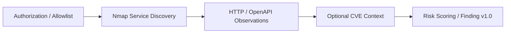

# Python ASM Framework

  
<a href="README.md">🇰🇷 한국어</a> · <strong>🇺🇸 English</strong>

  
  

---

> An Attack Surface Management prototype for analyzing **authorized assets**, service exposure, application endpoints and contextual CVE references.

## Why this project?

Port lists alone rarely communicate what an exposed service means. This prototype joins Nmap service discovery, optional HTTP/OpenAPI observations and public vulnerability references into an evidence-oriented risk summary.

## Capabilities and boundaries

| Component | Intended role |
| --- | --- |
| Scope guard | Explicitly authorized target allowlist |
| Service inventory | Port, service and version observations via Nmap integration |
| Application surface | HTTP headers, Swagger/OpenAPI, optional Selenium observations |
| Context enrichment | Optional Vulners / NVD references; **not vulnerability confirmation** |
| Risk scoring | Combines exposure, configuration, functionality and CVE context |
| Export | `result.json`, versioned `findings.json`, Markdown report |

**No exploitation, authentication bypass, malicious payloads, data alteration, or PoC validation** is claimed by this project.

## Recorded engineering evidence

- [PR #2](https://github.com/rasasoe/python-asm-framework/pull/2/files) documents allowlist/authorization checks, Finding v1.0 export and deterministic tests.
- **6 unit tests passed on September 16, 2026**, covering boundary checks, risk scores and normalization.
- This checkpoint did **not** validate live end-to-end Nmap, Selenium, or external CVE API collection. CVE matches are leads, not proven vulnerabilities.

## Where it fits

| Repository | Focus |
| --- | --- |
| [Python ASM Framework](https://github.com/rasasoe/python-asm-framework) | External asset/service exposure |
| [VSH](https://github.com/rasasoe/VSH) | Source and dependency security |
| [DotasPlus](https://github.com/rasasoe/DotasPlus) | External intelligence and IOC relationships |

Findings use a versioned export contract designed for potential later aggregation. No combined operational dashboard is claimed.

## Setup / tests / safe use

**[한국어 상세 README](README.md)** has the actual configuration and execution instructions. Use only infrastructure that you own or have permission to assess, and keep external API credentials out of version control.

---

*Python ASM Framework · Authorized Attack Surface Management Prototype*
